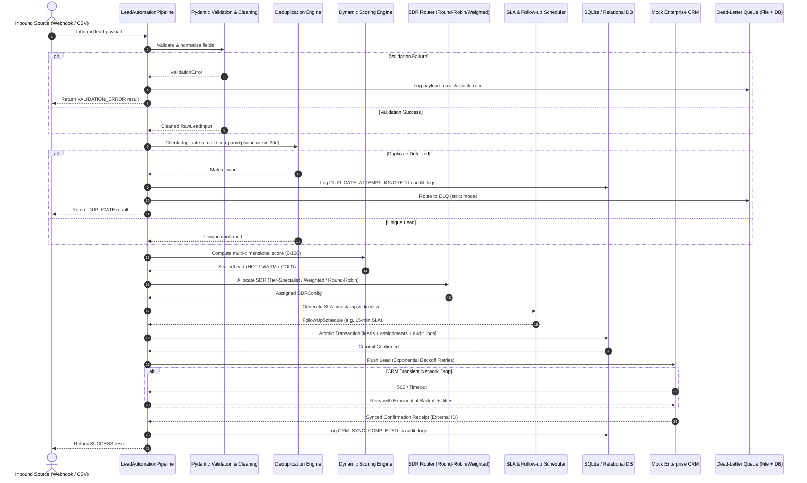
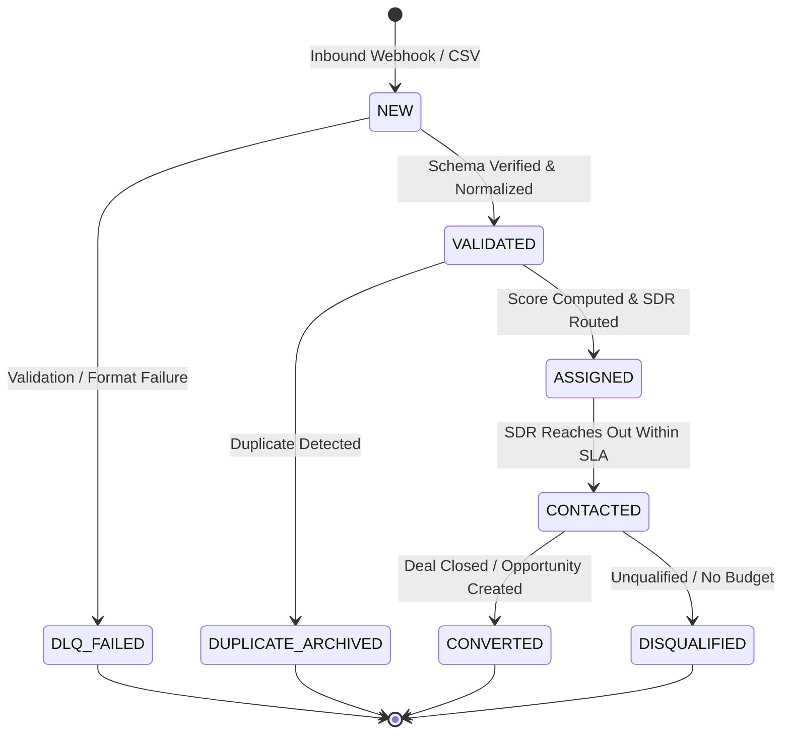
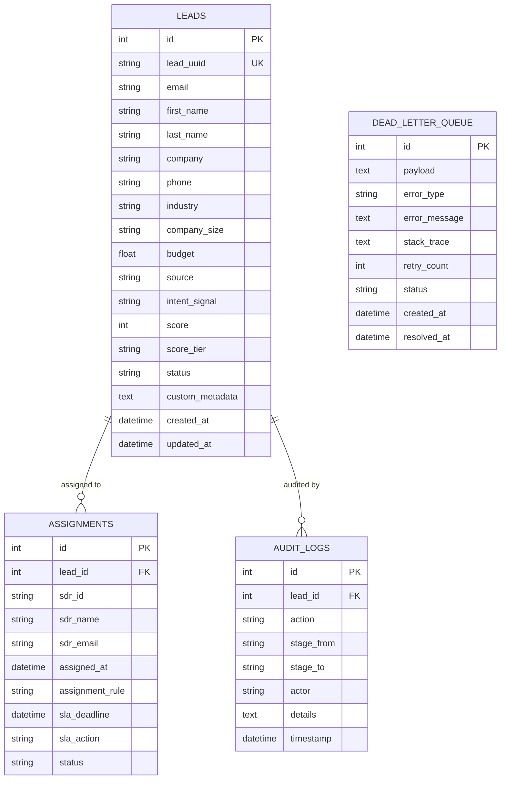

# System Architecture: Lead Management Automation

## 1. Executive & Architectural Overview

The **Lead Management Automation System** (Project C) is an enterprise-grade pipeline designed for automated inbound lead qualification, intelligent sales representative allocation, and fault-tolerant CRM synchronization. Built adhering to Clean Architecture principles, the system decouples validation, scoring rules, routing strategies, persistence, and external integration.

---

## 2. End-to-End Orchestration Flow

---

## 3. Pipeline State Machine

Leads progress through deterministic lifecycle stages. Transitions are strictly audited in the `audit_logs` table.

---

## 4. Entity-Relationship Data Model

The persistence layer uses SQLAlchemy ORM mapping to SQLite (or PostgreSQL in production):

---

## 5. Scoring Algorithm & Matrix

The scoring engine calculates qualification scores between 0 and 100 based on four criteria:

| Category | Criterion | Points (Max) | Evaluation Basis |
| :--- | :--- | :--- | :--- |
| **Firmographics** | Industry Sector | **25 pts** | Enterprise Software / SaaS (25), FinTech (25), Cybersecurity (25), Healthcare (20), Manufacturing (15), Retail (10), Other (5) |
| **Firmographics** | Company Size | **25 pts** | 1000+ employees (25), 501-1000 (22), 201-500 (18), 51-200 (14), 11-50 (8), 1-10 (4) |
| **Behavioral** | Intent Signals | **30 pts** | Request Demo (30), Contact Sales (28), Trial Signup (22), Pricing Page (20), Webinar (15), Whitepaper (12), Newsletter (6), Inquiry (8) |
| **Financial** | Budget Tier | **20 pts** | ≥\$100k (20), ≥\$50k (15), ≥\$25k (10), ≥\$10k (6), <\$10k (2) |

### Tier Classification:
- **HOT Tier (Score ≥ 75)**: High-intent enterprise prospects routed to Senior SDRs with a **15-minute SLA**.
- **WARM Tier (Score 45 - 74)**: Mid-market qualified prospects routed to Mid-Market SDRs with a **4-hour SLA**.
- **COLD Tier (Score < 45)**: Low-intent or micro-business leads flagged for **Automated Marketing Drip** sequences.

---

## 6. SDR Routing & Fair-Share Parity

1. **Round-Robin Routing**: Modulo-based cyclic allocation across active SDRs ensuring exact parity:
   $$\text{index} = \text{counter} \pmod N$$
2. **Weighted Routing**: Distributes leads according to SDR capacity, tenure, and quota targets using an interleaved deterministic sequence.
3. **Tier-Based Specialist Routing**: Partitions SDRs into specialized tier pools (`HOT`, `WARM`, `COLD`) and applies weighted distribution within each tier.
4. **Thread Safety**: All state updates are synchronized via re-entrant locks (`threading.Lock`), ensuring concurrency safety in multi-threaded webhook servers.

---

## 7. Fault Tolerance & Dead-Letter Queue (DLQ)

Invalid leads, duplicate collisions, or upstream network failures are isolated to protect pipeline throughput:
- **Dual Persistence**:
  1. Relational database table (`dead_letter_queue`) for administrative querying and reprocessing.
  2. Append-only JSON Lines file (`data/failed_leads.jsonl`) guaranteeing persistence even during database downtime.
- **Exponential Backoff Retries**: Upstream CRM pushes retry up to 3 times with exponential backoff and randomized jitter:
  $$\text{delay} = \min\left(\text{max\_delay}, \text{base\_delay} \times 2^{(\text{attempt}-1)}\right) + \text{jitter}$$
